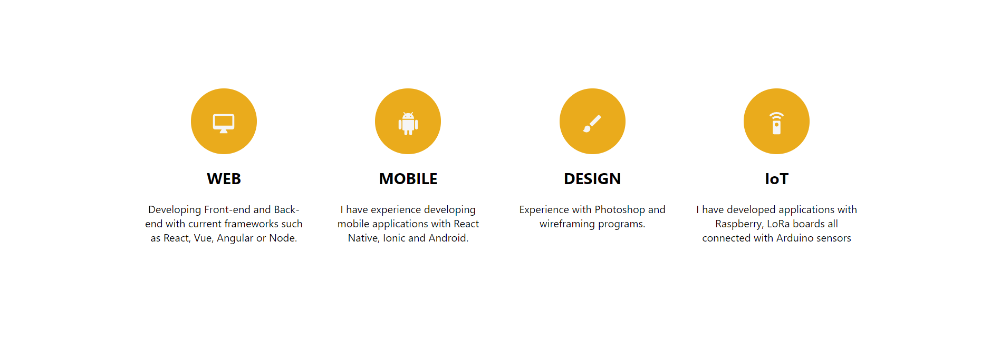
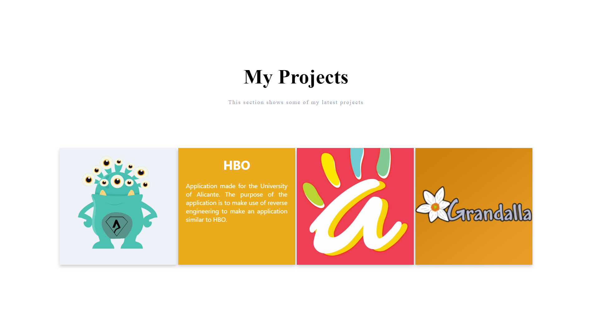

# LANDING

Personal landing page of Jaime Sarrión: a short presentation, skills and a selection of projects.





 **WHAT IS A LANDING PAGE?**

In digital marketing, a landing page is a standalone web page, created specifically for the purposes of a marketing or advertising campaign. It’s where a visitor “lands” when they have clicked on a Google AdWords ad or similar.

# Tech Stack

- [React 19](https://react.dev/)
- [Vite](https://vite.dev/) as the build tool and dev server
- [MUI Icons](https://mui.com/material-ui/material-icons/)
- [react-scroll](https://github.com/fisshy/react-scroll) for smooth scrolling between sections
- CSS Modules for component styles
- [Vitest](https://vitest.dev/) + [Testing Library](https://testing-library.com/) for tests
- [ESLint](https://eslint.org/) for linting

# Installation Guide

## Prerequisites

- [NodeJS](https://nodejs.org/es/download/) 22.22.2+, 24.15+ or 26+

## Installation

You have to execute the following commands:
- ``` npm install ```
- ``` npm run dev ``` — start the development server at http://localhost:5173

## Other commands

- ``` npm run build ``` — build for production into the `build` folder
- ``` npm run preview ``` — preview the production build locally
- ``` npm test ``` — run the tests with Vitest
- ``` npm run lint ``` — lint the code with ESLint

# Project Structure

```
├── index.html          # HTML entry point
├── public/             # Static files served as-is (favicon, manifest, robots.txt)
├── src/
│   ├── main.jsx        # App bootstrap
│   ├── App.jsx
│   ├── containers/     # Page layout
│   ├── components/     # Header, Presentacion, Competencias, Proyectos, Redes...
│   └── images/
└── vite.config.js      # Vite and Vitest configuration
```

# Deployment

Every push to `master` triggers the GitHub Actions workflow in `.github/workflows/deploy.yml`, which builds the site and uploads the `build` folder to the server over SSH.

# Authors

- [Jaime Sarrion](https://www.linkedin.com/in/jaime-sarrion-sahuquillo/)
